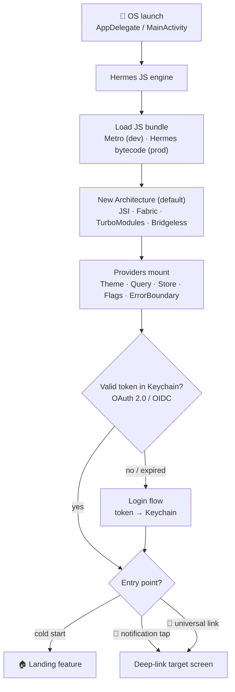
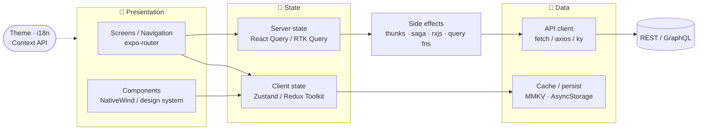
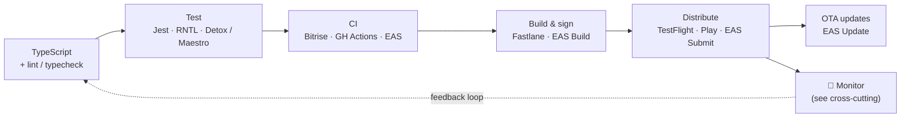

# 🌌 RNGalaxy

> A living reference for architecting **large, robust, maintainable React Native apps** — distilled from 9 years of building and shipping mobile products.

This repo is two things at once:

1. **A reference architecture** — a modern Expo app (SDK 56 · RN 0.85 · React 19 · expo-router · TypeScript, New Architecture on by default) that demonstrates how the pieces fit together.
2. **A field guide** — each topic below has its own deep-dive in [`docs/`](./docs), focused on **tradeoffs** (the *pros and cons*), not just "how to install X".

The architecture overview lives right here so you can see the whole picture at a glance; each box links out to its detailed discussion.

> **Companion demo apps** (built 2025, referenced throughout the docs for real code):
> [Aussie-RN](https://github.com/mzxyz/Aussie-RN) · [ContactsApp](https://github.com/mzxyz/ContactsApp)

---

## Architecture

I find it clearer to look at an RN app through **three separate views** rather than one giant diagram — because they run on different timelines:

- **Runtime / boot** — what happens on every cold start.
- **App layers & data flow** — how a running app moves data around.
- **Delivery pipeline** — how code becomes a shipped, monitored app.

…wrapped by a set of **cross-cutting concerns** (observability, notifications, flags, security, theming) that touch all three.

### 1. Runtime — cold start & boot flow

From native launch to the first feature screen. The **New Architecture** (JSI · Fabric · TurboModules · Bridgeless) is the *foundation* here — it's the default in SDK 56, not a feature you bolt on. Note the multiple **entry points**: a plain launch, a notification tap, or a universal link can each route to a different screen.



### 2. App layers & unidirectional data flow

The steady state. The key distinction is **client state** (UI/session — Zustand or Redux Toolkit) vs **server state** (cached remote data — React Query / RTK Query). Theme and i18n ride alongside via the Context API.



### 3. Delivery pipeline

How code reaches users — and how production feeds back into development via observability.



### Cross-cutting concerns

These don't sit on a single timeline — they wrap the whole app. Note **Firebase is a suite**: its Messaging product powers notifications while Crashlytics / Analytics / Performance feed observability — one vendor spanning multiple concerns.

| Concern | Tools | Deep dive |
|---|---|---|
| 🔔 Notifications / Push | FCM (`@react-native-firebase/messaging`), `expo-notifications`, APNs | `messaging/11-notifications` |
| 💥 Crash reporting | Sentry, Firebase **Crashlytics** | `observability/17` |
| 📊 Product analytics | **Amplitude**, Firebase **Analytics** | `observability/17` |
| ⚡ Performance / APM | Datadog, Firebase **Performance** | `observability/17` |
| 🚩 Feature flags | LaunchDarkly | `platform/08-feature-flags` |
| 🔐 Secure storage / tokens | `react-native-keychain` | `platform/09-secure-storage-keychain` |
| 🎨 Theming / i18n | Context API, i18next | `ui/05-styling` |

### Recommended folder structure

Feature-based, so a feature's UI, hooks, data and state live together (easy to navigate, easy to delete). Routes stay thin — they compose features.

```
src/
├── app/              # expo-router routes (thin — screens compose features)
├── features/         # self-contained feature modules
│   └── <feature>/
│       ├── components/
│       ├── hooks/
│       ├── api/      # React Query queries/mutations
│       ├── store/    # local Zustand slice (if needed)
│       └── index.ts  # public surface of the feature
├── components/       # shared UI / design-system primitives
├── lib/              # cross-cutting: api client, storage, analytics, flags
├── hooks/            # shared hooks
├── store/            # global client state
├── theme/            # theme tokens + ThemeProvider
├── constants/
└── types/
```

---

## Topics

Deep-dive discussions in [`docs/`](./docs). Each is tradeoff-driven and (where relevant) links to real code in the companion demo apps.

| Area | Topic | Status |
|---|---|---|
| **State** | State management — Zustand vs Redux + RTK vs Context | 🚧 Planned |
| **State** | Async actions — RTK Query vs React Query vs thunks/sagas/rxjs | 🚧 Planned |
| **Data** | Data fetching — React Query patterns, cache, offline | 🚧 Planned |
| **Data** | Storage & cache — AsyncStorage vs MMKV | 🚧 Planned |
| **UI** | Styling — NativeWind vs StyleSheet vs styled-components | 🚧 Planned |
| **UI** | Component libraries & design systems | 🚧 Planned |
| **Navigation** | expo-router vs react-navigation; deep links (universal + in-app) | 🚧 Planned |
| **Platform** | Feature flags — LaunchDarkly & alternatives | 🚧 Planned |
| **Platform** | Secure storage — Keychain + optimization | 🚧 Planned |
| **Platform** | Auth — Auth0, OpenID Connect, OAuth 2.0 / PKCE | 🚧 Planned |
| **Messaging** | Notifications — Firebase/FCM, foreground vs background | 🚧 Planned |
| **Quality** | Testing — unit (Jest/RNTL), E2E (Detox vs Maestro) | 🚧 Planned |
| **Quality** | Debugging tools | 🚧 Planned |
| **Delivery** | CI — Bitrise vs GitHub Actions vs EAS | 🚧 Planned |
| **Delivery** | Deployment — Fastlane, EAS Build/Submit, OTA | 🚧 Planned |
| **Delivery** | Bundle analysis & performance | 🚧 Planned |
| **Observability** | Sentry, Amplitude, Firebase suite, Datadog | 🚧 Planned |
| **Tooling** | AI tools for React Native development | 🚧 Planned |

---

## Getting started

```bash
npm install
npx expo start        # then press i (iOS) / a (Android) / w (web)
```

## Tech stack baseline

| Layer | Choice |
|---|---|
| Framework | Expo SDK 56, React Native 0.85, React 19 |
| Language | TypeScript |
| Architecture | New Architecture (Fabric / TurboModules / Bridgeless), React Compiler |
| Routing | expo-router (typed routes) |
